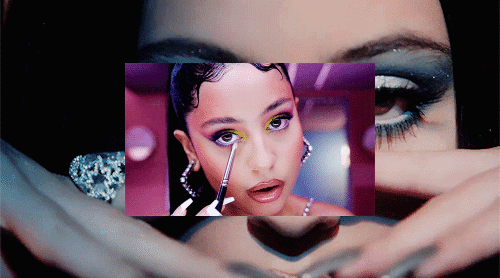
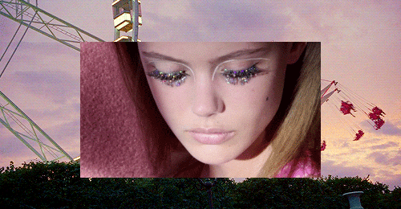

# GIF Layer Studio

Локальний редактор для поєднання двох зображень в одну GIF. Підтримує GIF, JPG і PNG в обох шарах. Працює у браузері без встановлення, інтернету та завантаження файлів на сервер.

## Як запустити

Відкрий [GIF Layer Studio](https://annaholovach.github.io/gif-layer-studio/) у браузері на телефоні або комп’ютері. Для локального запуску відкрий файл **index.html** подвійним клацанням. Якщо система запитає програму, вибери браузер, наприклад Chrome або Edge.

## Як створити GIF

1. У полі **«Фонове зображення»** вибери GIF, JPG або PNG. Цей файл визначає пропорції та оригінальний розмір результату.
2. У полі **«Верхній шар»** вибери другий файл. Він з’явиться поверх фону.
3. Перетягни верхній шар мишкою або пальцем. Для точного розташування використовуй **«Позиція X»** та **«Позиція Y»**.
4. Налаштуй **«Розмір»** і **«Прозорість»** верхнього шару. **«По центру»** розташує його посередині полотна.
5. Перевір результат у попередньому перегляді. **«Пауза»** зупиняє відтворення, а **«Від початку»** повертає обидві анімації до першого кадру.
6. За бажанням зміни швидкість фону або верхнього шару повзунками в блоці **«Швидкість анімації»**.
7. У блоці експорту вибери розмір файла й налаштування згладжування.
8. Натисни **«Зібрати та експортувати GIF»**. Дочекайся повідомлення про готовність і натисни **«Завантажити готову GIF»**.

GIF-шари відтворюються одночасно; JPG і PNG залишаються нерухомими. Якщо обидва файли нерухомі, результат буде однокадровою GIF.

## Швидкість анімації

Фон і верхній шар можна прискорювати та сповільнювати окремо. Наприклад, залишити фон у звичайному темпі, а рух поверх нього зробити повільнішим. Для цього пересувай відповідний повзунок: ліворуч — повільніше, праворуч — швидше.

**1×** означає початкову швидкість GIF. На **0,5×** анімація рухається вдвічі повільніше, а на **2×** — удвічі швидше. Можна вибрати швидкість від **0,25×** до **3×**. Під кожним повзунком видно, скільки тепер триває один повний цикл анімації.

Після зміни швидкості перегляд починається спочатку. Вибраний темп зберігається й у готовій GIF. Щоб повернути обом шарам звичайну швидкість, натисни **«Скинути швидкість обох»**.

Повзунки доступні лише для анімованих GIF. JPG, PNG та GIF з одним кадром залишаються нерухомими, тому змінювати їхню швидкість не потрібно.

Тривалість результату залежить від довшого циклу з урахуванням вибраної швидкості, але обмежена 12 секундами. Поки довша анімація відтворюється, коротша повторюється. Наприклад, якщо після налаштування фон має цикл 4 секунди, а верхній шар — 2 секунди, у готовій GIF верхній шар повториться двічі.

## Розмір файла

| Варіант | Ширина та висота відносно фонового зображення |
| --- | --- |
| Оригінал | 100% — розміри фонового зображення |
| Великий | 75% |
| Середній | 50% |
| Маленький | 25% |

Пропорції зберігаються. Наприклад, для фону 800 × 600 px варіант «Середній» дасть 400 × 300 px. Це відсотки розмірів зображення, а не ваги файла: точний розмір у МБ залежить від кольорів, руху та кількості кадрів. Редактор показує розміри в пікселях перед експортом і вагу файла після нього.

**«Згладжувати колірні переходи (дизеринг)»** допомагає зробити переходи кольорів плавнішими. Якщо помітна дрібна зернистість, спробуй вимкнути цю опцію та порівняти результати. Для кожного кадру редактор підбирає окрему палітру.

## Почати нову роботу

- **«Скинути»** повертає початкові розмір, прозорість і позицію верхнього шару; завантажені файли залишаються.
- **«Скинути швидкість обох»** повертає фон і верхній шар до **1×**.
- **«＋ Створити нову GIF»** повністю очищає обидва файли, перегляд, налаштування та посилання на результат. Після цього можна завантажити нові зображення. Уже збережені файли на комп’ютері залишаються.

## Особливості експорту

- Результат завжди зберігається у форматі **GIF**.
- Тривалість — довший із двох анімованих циклів з урахуванням вибраної швидкості, але не більше **12 секунд**. Коротша анімація повторюється.
- GIF має обмежену палітру: відтінки можуть трохи відрізнятися від JPG або PNG.
- Прозорий фон підтримується, але GIF зберігає лише повністю прозорі або непрозорі пікселі. Напівпрозорий верхній шар змішується з фоном.
- Великі зображення та довгі анімації потребують більше часу й пам’яті. Якщо файл не завантажується, спробуй зменшити його розміри або кількість кадрів.

## Приклади результатів

Нижче — три GIF-зразки з папки проєкту.

### Приклад 1

500 × 278 px · 19 кадрів

### Приклад 2

500 × 260 px · 26 кадрів

